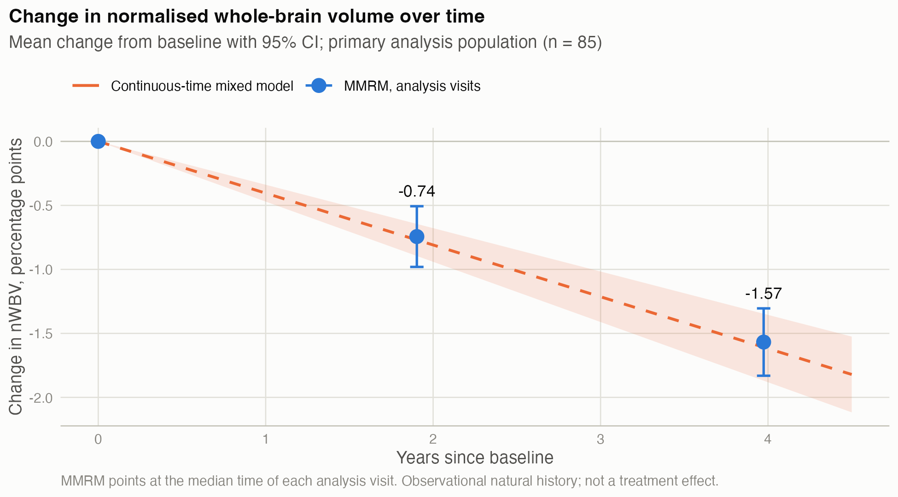

# Natural-history MMRM and trial simulation in OASIS-2

[](https://github.com/rushadnihal/oasis2-mmrm-trial-simulation/actions/workflows/ci.yml)

Trial-style longitudinal biostatistics on OASIS-2, an observational MRI cohort of 150 older adults: a statistical analysis plan frozen before any outcome was examined, an MMRM analysis of brain-volume decline with an ICH E9(R1) estimand, missing-data sensitivity analyses, a SAS/R cross-check, and a simulation study of the operating characteristics of a two-arm trial built on the fitted model.

**What this is not.** OASIS-2 has no treatment arm, and no real treatment effect is estimated anywhere. The between-group contrast fitted in Part A is an observational association used only to exercise the code for the SAS/R cross-check. The project makes no clinical claims about Alzheimer's disease and does not combine OASIS-2 with any other dataset.

Full write-up: [`report/report.pdf`](report/report.pdf).

## Headline results

| Question | Answer | Evidence |
|---|---|---|
| How fast does normalised whole-brain volume (nWBV) fall in cognitively normal older adults? | -0.744 percentage points of intracranial volume at about 2 years (95% CI -0.981 to -0.507; 75 participants), -1.568 at about 4 years (-1.831 to -1.305; 42 participants) | Primary MMRM, [`results/part_a/T4.csv`](results/part_a/T4.csv) |
| Is the decline steady? | Yes: about -0.405 pp per year, and the continuous-time model agrees with the MMRM within 0.04 pp | [`T6.csv`](results/part_a/T6.csv) |
| Is the primary result robust? | Every sensitivity analysis (covariance, time model, visit definition, population model) lies inside the primary 95% CI | [`T5.csv`](results/part_a/T5.csv), [`T6.csv`](results/part_a/T6.csv) |
| Does missing data threaten it? | Not at 2 years: across a delta-adjustment grid to -1.0 pp the estimate moves less than one SE. At 4 years (half missing) the size is sensitive; every 95% CI still excludes zero | [`T7.csv`](results/part_a/T7.csv) |
| Does MMSE capture the change? | No: change is small with CIs including zero, and half of those seen at 4 years still score the maximum of 30 | [`T8.csv`](results/part_a/T8.csv) |
| Do SAS and R agree? | Estimates and covariance parameters within 1e-6; standard errors within 1e-6 once R uses the linear Kenward-Roger adjustment that matches SAS DDFM=KR | [`sas/crosscheck/crosscheck_report.md`](sas/crosscheck/crosscheck_report.md) |
| Is the MMRM a valid analysis for a trial on this endpoint? | Type I error 4.3% to 6.0% under ignorable dropout; up to 9.0% under differential missing-not-at-random dropout. No fitting failures in 888,000 simulated trials | [`results/simulation/`](results/simulation/) |
| How big would a trial need to be? | 64 per arm for 80% power to detect a 30% slowing of decline at about 4 years; 86 with 30% dropout | [`T11.csv`](results/simulation/T11.csv) |
| What does reference-based imputation cost? | It is conservative (type I error 0.1% to 1.5%) and less powerful: 58% (jump to reference) against 83% (MMRM) at 200 per arm, 20% slowing, 30% dropout | [`T10.csv`](results/simulation/T10.csv) |

Honest limits: 85 participants in the primary population and two post-baseline visits; one volunteer cohort with no external validation; few participants progress on CDR, so progression questions are underpowered; the simulation inherits a 4-year estimate based on 42 people and assumed dropout mechanisms.



## Design principles

- **Plan before outcomes.** [`docs/SAP_v1.0.md`](docs/SAP_v1.0.md), tagged `sap-v1.0`, was written from counts, visit timing and baseline quantities only. Every decision and deviation is listed in the report with whether it came before or after outcomes were seen.
- **Count-only checks drove the design.** Quality control showed that the file's visit label does not track session timing, so analysis visits are defined by time windows; the label scheme is kept as a sensitivity analysis.
- **Two implementations.** The primary model is fitted in R (`mmrm`) and SAS (`PROC MIXED`) and compared against pre-specified tolerances.
- **Simulation reported properly.** ADEMP structure, Monte Carlo standard errors, reproducible random-number streams, and fitting failures counted rather than dropped.
- **Tested before it touches data.** Every script runs in CI on a synthetic dataset first.

## Estimand

| Attribute | Natural history (Part A) | Simulated trial (Part B) |
|---|---|---|
| Population | Adults with CDR 0 at baseline | Virtual adults with the same baseline distribution |
| Variable | Change from baseline in nWBV at about 2 years | Change from baseline at about 4 years |
| Progression to CDR 0.5 or above | Treatment policy: measurements used regardless | Same |
| Dropout | Missing data: MAR in the primary analysis, MNAR in sensitivity analyses | Same |
| Summary measure | Mean change | Difference in mean change between arms |

A hypothetical strategy would instead ask what would have happened had nobody progressed; a composite strategy would count progression as a poor outcome; reference-based imputation, used in Part B, asks what happens if participants who drop out lose any treatment benefit.

## Repository

| Path | Content |
|---|---|
| `docs/SAP_v1.0.md`, `docs/data-use-statement.md` | Frozen analysis plan; data-handling rules |
| `R/00` to `R/02b` | Dataset confirmation, quality control, analysis datasets, visit-scheme check (counts only) |
| `R/03` to `R/06` | Part A: primary MMRM, robustness, secondary endpoints and sex contrast, missing data |
| `R/07a`, `sas/`, `R/07b` | SAS/R cross-check on synthetic data |
| `R/sim/`, `R/08` to `R/10` | Part B: data-generating mechanism, pilot, full simulation, performance summary |
| `R/11`, `R/12` | Publication tables and figures (small-cell rule applied) |
| `R/synthetic/` | Synthetic dataset generator (hand-chosen parameters; no real rows) |
| `results/` | Aggregate tables, figures and simulation results |
| `report/` | Quarto source and rendered PDF |
| `Makefile`, `.github/workflows/ci.yml`, `scripts/` | Pipeline targets, CI, check that no participant data are tracked |

## Reproduce

Without the data:

```
make synth-ci      # synthetic data through every script
make report        # render the report from the committed results (needs Quarto)
```

With the data: obtain OASIS-2 from [oasis-brains.org](https://www.oasis-brains.org) under your own data use agreement, set `OASIS2_DATA_DIR` (and optionally `OASIS2_REPORT_DIR`) in `.Renviron`, then `make data-check build analysis results`. The simulation (`make sim`) needs no data and takes about 8 hours on 7 cores.

R 4.5 with `mmrm`, `emmeans`, `nlme`, `mice`, `rbmi`, `ggplot2`, `readxl`, `knitr`, `rmarkdown`; Quarto 1.4 or later for the report.

## Data and licence

No OASIS-2 data are included. All published results are aggregate; no count below 5 is shown. See [`docs/data-use-statement.md`](docs/data-use-statement.md).

Data were provided [in part] by OASIS-2: Longitudinal: Principal Investigators: D. Marcus, R, Buckner, J. Csernansky, J. Morris; P50 AG05681, P01 AG03991, P01 AG026276, R01 AG021910, P20 MH071616, U24 RR021382

Code: MIT. Results are summary outputs subject to the OASIS data terms.
